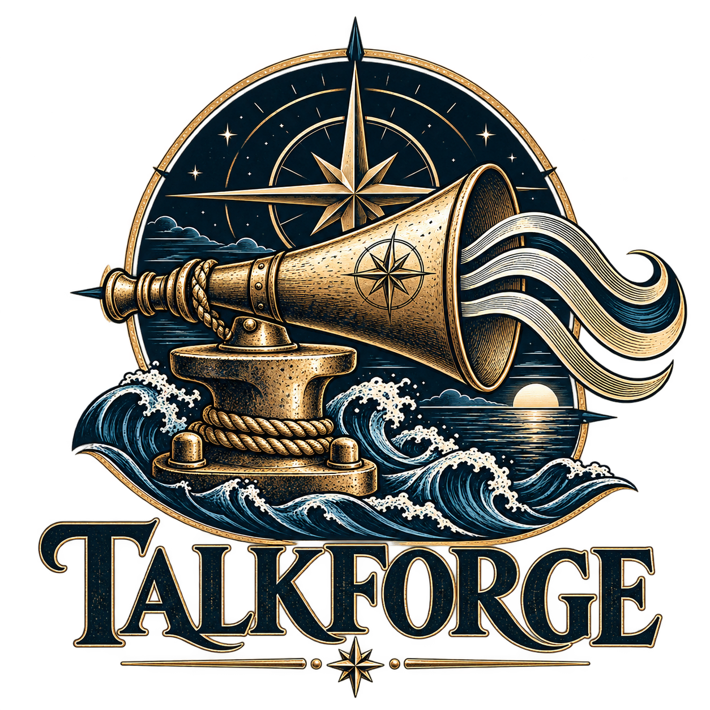

<p align="center">
  
</p>

# TalkForge

> client-side neural text-to-speech (Piper, ONNX Runtime Web/WASM) with offline local assets.

Client-side neural text-to-speech in the browser. Runs Piper TTS models entirely in-browser (ONNX Runtime Web + WASM) with multi-speaker support, local-asset offline mode, and simple static servers for Linux and constrained Windows environments.

## Quick start

### Linux / macOS
```bash
git clone https://github.com/fleethacker-data-crucible/talkforge.git
cd talkforge
./populate-assets.sh          # optional: downloads large models if not using a Release
./serve.sh                    # starts on http://127.0.0.1:25000 (or next free port)
```

### Windows (PowerShell 5.1, no admin)
```bat
git clone https://github.com/fleethacker-data-crucible/talkforge.git
cd talkforge
populate-assets.bat           # optional: downloads large models
serve.bat                     # starts the local server and opens the page
```

`serve.bat` uses port block **25000-25009** (edge-ops PORTS.md). Launching it while TalkForge is already running opens the running copy instead of starting another; an older running copy is asked to stop (`POST /__fleethacker/shutdown`) and replaced. `-Port <n>` uses exactly that port. `GET http://127.0.0.1:<port>/__fleethacker/id` reports the running tool, version (the page's `PAGE_VERSION`), pid and script path.

Open `TalkForge-tts.html` in a browser. The page loads everything from the local `assets/` folder and makes no CDN or other external requests. If a model or WASM file is missing it stops with an error instead of fetching it from the internet; run `populate-assets` to download the files from the pinned GitHub Release.

## What’s in the repo vs. a Release

| In the repo (cloned) | In a GitHub Release (`.0` series only) |
|----------------------|----------------------------------------|
| Source, scripts, CI, docs | All `.onnx` model files |
| Small JS (piper-tts-web, lamejs, engine) | `piper_phonemize.data` (~17 MB) |
| Small WASM (`piper_phonemize.wasm`) | ONNX Runtime WASM binaries |
| `.onnx.json` configs | `release-base.txt` stamp |

### Asset storage policy

Large model and WASM files are uploaded **only** on series releases that end in `.0` (for example `v1.1.0`).  
Patch releases (`v1.1.1`, `v1.1.2`, …) reuse those same assets and do not re-upload them.

The populate scripts always request the matching `.0` series URL, so a clone or source zip from any patch release still finds the models.

```bash
# Series release (uploads large assets)
git tag v1.1.0
git push origin v1.1.0

# Patch release (stamp only, no large assets)
git tag v1.1.1
git push origin v1.1.1
```

After the workflow finishes, `populate-assets.sh` / `.ps1` / `.bat` will pull the large files from the `.0` release of the repo the script is running in (or from the stamped `assets/release-base.txt`).

### No CDN fallback

`populate-assets` downloads from the GitHub Release only. The upstream URLs in `assets-manifest.json` (CDN, Hugging Face) are used only when you opt in with `-AllowUpstream` (PowerShell) or `TALKFORGE_ALLOW_UPSTREAM=1` (shell); downloads are still SHA-256 verified. The page and the Node tools never make network requests.

### Integrity checks

Every asset in `assets-manifest.json` has a `sha256`. `populate-assets` downloads to a `.part` file, verifies it, and only then moves it into place; a mismatch is reported (expected vs actual), the file is not kept, and the script exits with code 1. Files already present are verified too. `.json` configs are hashed with CR bytes removed so CRLF checkouts match. `-Only` (PowerShell) or `TALKFORGE_ONLY` (shell) limits the run to wildcard patterns, for example `models/en_US-lessac-high*,wasm/*,vendor/onnx/*.jsep.wasm`.

If the page cannot find a file it needs, it lists exactly which `assets/...` files are missing and what to run.

## Features

- Multi-speaker models (LibriTTS-R, VCTK) with searchable speaker list
- Background first-sentence synthesis for faster start
- Read-all / selection / click-to-read modes
- MP3 download of generated audio
- Speed control
- Debug panel with copy-to-clipboard
- Pure-function test suite (`node tests/tts-utils.test.mjs`)
- GitHub Actions tests (unit + offline synthesis smoke test; failures block the PR check)

## Layout

```
TalkForge-tts.html
assets/
  vendor/          # JS libraries and engine
  wasm/            # phonemizer WASM (data + onnx/ come from Release)
  models/          # .onnx.json configs (models come from Release)
populate-assets.sh / .ps1 / .bat
serve.sh / serve-windows.ps1 / serve.bat
tools/             # synth-cli.mjs (voiceover CLI), node-engine.mjs, synth-lib.mjs
tests/
.github/workflows/
```

## Voiceover CLI (demo narration)

`tools/synth-cli.mjs` turns a script into one audio file per scene plus a timing file, from the command line, fully offline (local assets only, no browser, no network). It runs the same Piper engine as the page under Node 18 or newer.

```bash
node tools/synth-cli.mjs script.json --out audio            # WAV, default voice en_US-lessac-high
node tools/synth-cli.mjs script.txt  --out audio --format mp3 --speed 1.05
```

**Script.** Plain text (one scene per blank-line paragraph, ids `scene-01`, `scene-02`, ...) or JSON:

```json
{
  "voice": "en_US-lessac-high", "speed": 1.0, "sceneGap": 0.4,
  "pronunciations": { "PacketRat": "packet rat" },
  "scenes": [
    { "id": "intro", "text": "PacketRat triages your inbox." },
    { "id": "close", "text": "Thanks for watching.", "speed": 0.95, "voice": "en_US-amy-medium", "speaker": 0, "pauseAfter": 1 }
  ]
}
```

A bare array of scenes (or of strings) also works. `text` may be written `tts`. `id` becomes the file name (letters, digits, `. _ -`). `speed` is 1 = normal, 1.1 = 10 percent faster (0.25 to 4); it is applied once, as the model length scale. `pronunciations` are whole-word, case-insensitive replacements, like the page's pronunciation box.

**Options.** `--out <dir>` (default `./voiceover`), `--voice`, `--speed`, `--speaker`, `--format wav|mp3` (mono, 22.05 kHz; MP3 is 128 kbps), `--scene-gap <sec>`, `--sentence-gap <sec>` (default 0.32, silence between sentences inside a scene), `--assets <dir>` (default `assets/` or env `TALKFORGE_ASSETS`).

**Output.** `<out>/<id>.wav|mp3` and `<out>/timing.json`:

```json
{ "script": "script.json", "voice": "en_US-lessac-high", "format": "wav", "sampleRate": 22050,
  "sentenceGap": 0.32, "totalSeconds": 6.317,
  "scenes": [ { "id": "intro", "file": "intro.wav", "start": 0, "duration": 3.095,
                "voice": "en_US-lessac-high", "speed": 1, "speaker": 0, "text": "..." } ] }
```

`start` and `duration` are in seconds. Scenes are laid end to end: the next `start` is the previous `start` + `duration` + that scene's `pauseAfter` (default `--scene-gap`, default 0). Files contain no trailing silence, so a renderer can place each file at its `start`. `text` is the text after pronunciation replacement.

**Exit codes.** 0 ok; 1 error (bad script, silent output, engine failure); 2 assets missing (the message lists each missing file, and nothing is downloaded); 64 bad usage.

**Assets.** The default voice needs `models/en_US-lessac-high.onnx` and its `.json`, `vendor/onnx/ort-wasm-simd-threaded.jsep.wasm` and `wasm/piper_phonemize.wasm` + `.data`. Get them with `populate-assets`. From another script, `import { synthesizeScript } from './tools/synth-cli.mjs'` returns the same timing object.

Run the tests with `node tests/synth-cli.test.mjs`; the end-to-end case is skipped when the assets are absent (set `TALKFORGE_REQUIRE_ASSETS=1` to make that a failure).

## Headless mode (for other apps)

`talkforge speak` and `talkforge serve` (`talkforge.cmd` on Windows, `./talkforge` elsewhere; both run `tools/talkforge.mjs`, Node 18 or newer) let other apps use TalkForge without a browser. Everything is offline and uses the local assets; nothing is downloaded.

```bash
talkforge speak "Build finished." --out done.wav            # text from arguments
echo "Piped text." | talkforge speak --format mp3 > out.mp3   # text from stdin, audio to stdout
TALKFORGE_TOKEN=<16+ chars> talkforge serve                    # endpoint on 127.0.0.1:25009
```

`speak` options: `--out <file|->`, `--voice` (default en_US-lessac-high), `--speed` (1 = normal), `--speaker`, `--format wav|mp3`, `--assets <dir>`. Exit codes: 0 ok, 1 error, 2 assets missing, 64 bad usage.

**Endpoint.** `serve` listens on **127.0.0.1 only** (there is no host option; default port 25009, the last port of TalkForge's block) and refuses to start without a token of 16+ characters, taken from env `TALKFORGE_TOKEN` or the first line of `--token-file`. The token is never printed or stored. Every request needs `Authorization: Bearer <token>`; requests with a non-loopback Host or any Origin header are refused with 403, bodies over 64 KB with 413.

```bash
curl -s http://127.0.0.1:25009/v1/audio/speech -H "Authorization: Bearer $TALKFORGE_TOKEN"   -H "Content-Type: application/json" -d '{"input":"Hello.","response_format":"mp3"}' -o hello.mp3
```

The request follows OpenAI `/v1/audio/speech` so Fairlead can route to it: `input` (up to 10,000 characters), `voice`, `speed` (0.25 to 4), `response_format` (`wav` default, or `mp3`), plus `speaker`. A `voice` that is not an installed Piper voice (for example `alloy`) falls back to the default voice; the voice used is in the `X-TalkForge-Voice` response header. Missing assets return 503 with the file list. Requests are synthesized one at a time.

Tests: `node tests/headless.test.mjs` (the end-to-end cases skip without local assets).

## License

MIT for the page and scripts. Model files follow the licenses of the upstream Piper voices (see each model’s MODEL_CARD on Hugging Face).

