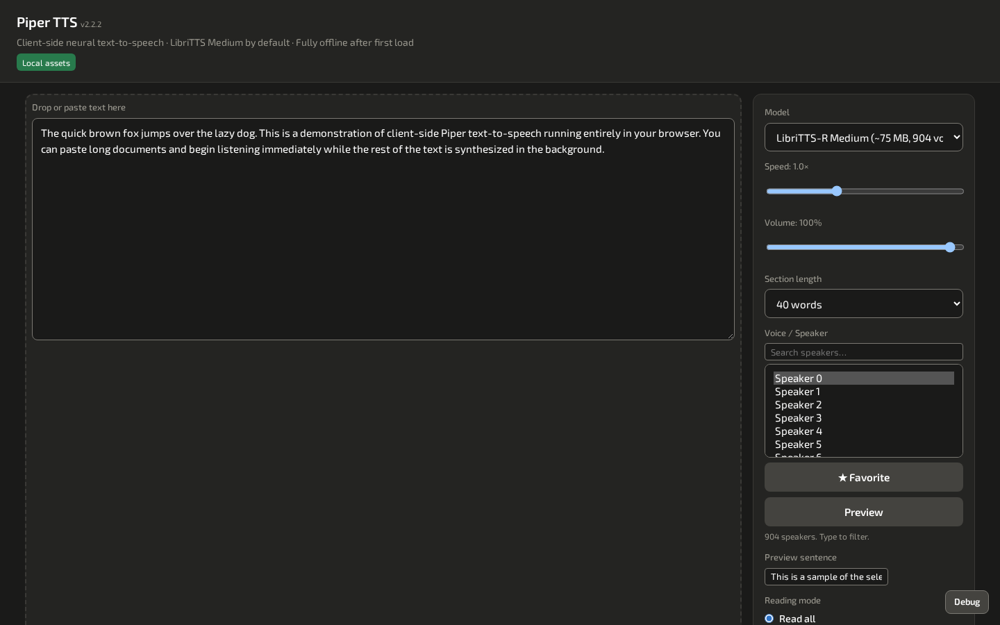
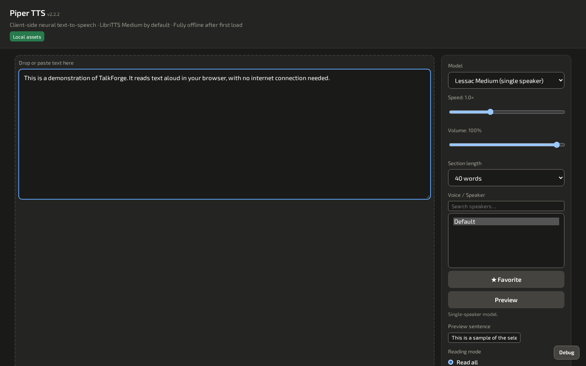
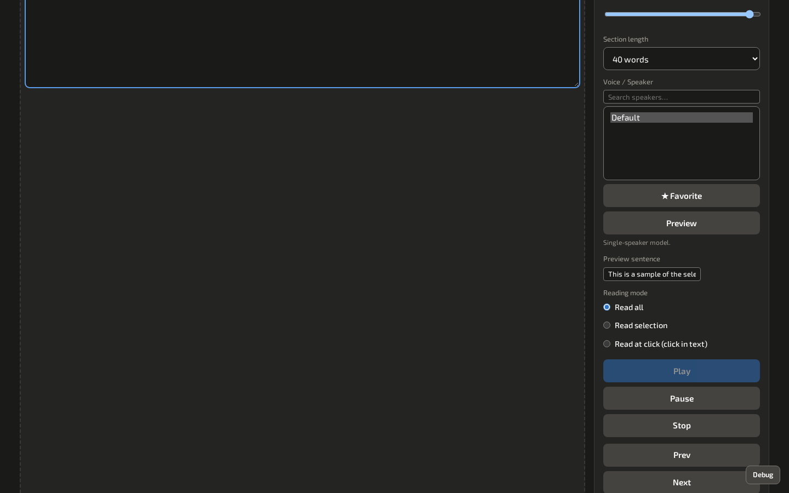
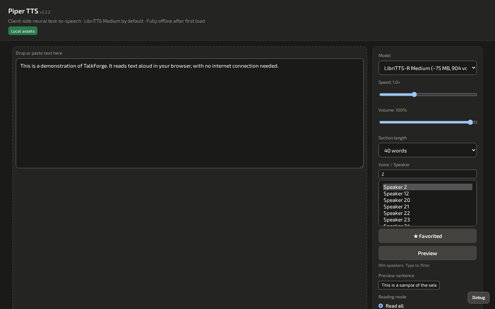
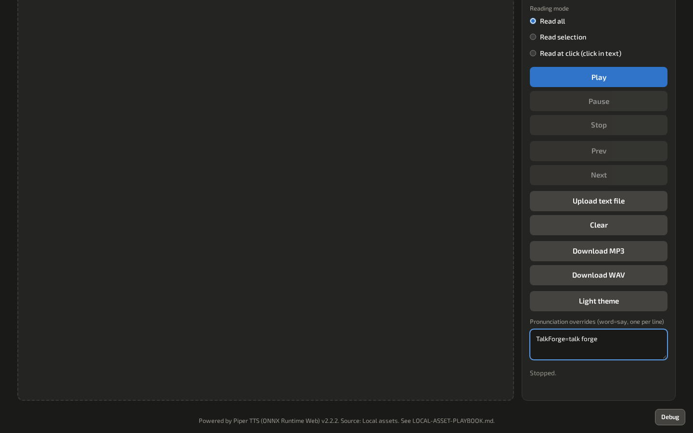

# TalkForge walkthrough

Turn text into natural speech entirely in the browser, offline, and download it as MP3 or WAV.

> **Screenshots:** captured with demo data and scanned by the Chief of Staff (team directive 10).

## Before you start

- Windows PowerShell 5.1 (part of Windows). No administrator rights and no installer.
- Microsoft Edge or Google Chrome.
- Launch: Run `populate-assets.bat` once for the voice models, then `TalkForge.bat` (`serve.bat` still works) (opens `http://127.0.0.1:25000` or the next free port).

## Steps

### 1. First launch

TalkForge opens with the text box, the model and voice pickers and the playback controls. The page header reads *TalkForge-tts* and the page version (v2.2.3 at the time of writing). The speech engine underneath is Piper TTS, credited in the page footer.

### 2. Add text and pick a voice

Paste or drop text, then choose a model, voice and speed.

### 3. Listen

Select **Play**. Use **Pause**, **Stop**, **Prev** and **Next** to move through the text. **Reading mode** chooses whether to read everything, the selection, or from where you click.

### 4. Choose a speaker

Multi-speaker models have a searchable speaker list. Speakers are named *Speaker N*, so search by number. Select **Favorite** to mark the ones you like.

### 5. Fix a pronunciation

Add `word=say` lines under **Pronunciation overrides**.

### 6. Download

Select **Download MP3** or **Download WAV** to save the audio of your text.

## About these images

Images live in [`docs/assets/walkthrough/`](../assets/walkthrough/), named `NN-<screen>.png` after the step they belong to. They are 1440x900 at 100% scale in the Dark theme, and show demo data only.
